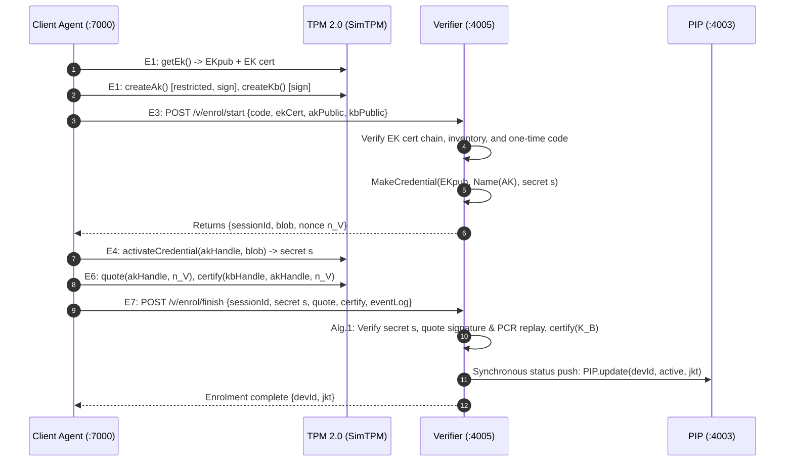
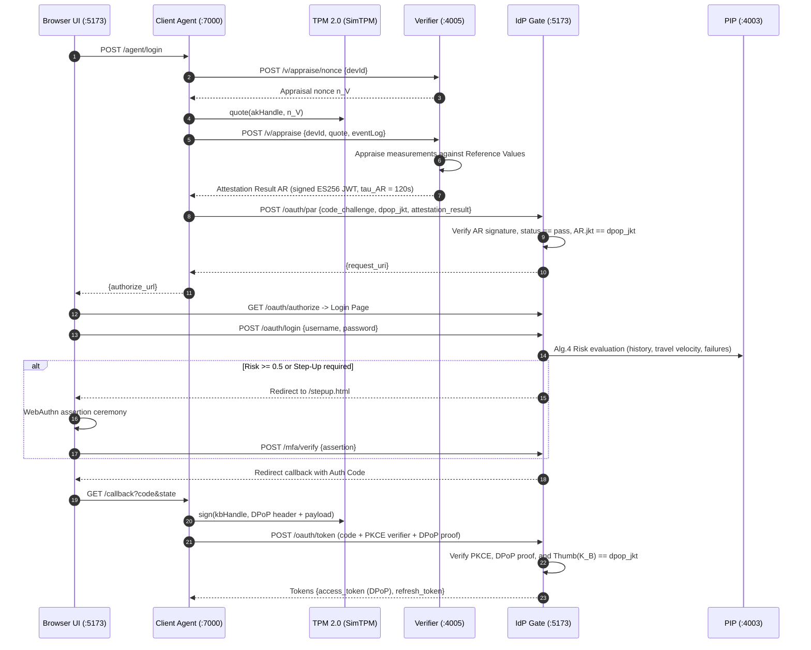
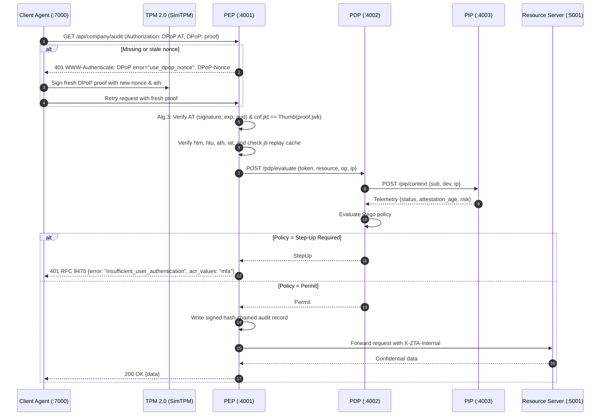
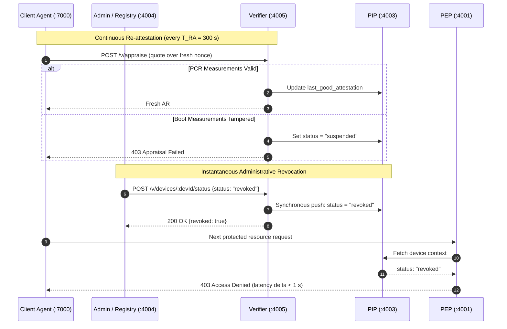

# Hardware-Rooted Zero-Trust Architecture (ZTA) with TPM, OIDC & DPoP

This repository implements a complete, hardware-rooted **Zero-Trust Architecture (ZTA)** that integrates device hardware attestation, user identity, cryptographically bound tokens, and dynamic policy evaluation.

By combining **TPM 2.0 Remote Attestation**, **Proof-of-Possession (RFC 9449 DPoP)** at the application layer, **OAuth 2.0 Pushed Authorization Requests (RFC 9126 PAR)**, **WebAuthn FIDO2 MFA**, and continuous policy evaluation (PEP/PDP/PIP with Rego/OPA-equivalent rules), this system guarantees that only verified users on authorized, untampered devices can access protected enterprise resources.

---

## 🛠️ Architectural Overview

The architecture enforces zero trust across four core phases:
1. **Device Enrolment & Binding (E1–E9)**: The client agent generates an Attestation Key (AK) and a DPoP Binding Key ($K_B$) inside the TPM. The Verifier validates the Endorsement Key (EK) certificate chain, verifies hardware attributes, challenges the TPM via `MakeCredential` / `ActivateCredential`, and validates quotes and certification of $K_B$ over a fresh nonce.
2. **Device Appraisal & Token Issuance (L1–L15)**: The client appraises boot measurements against Reference Values (RV) to receive a signed Attestation Result (AR). The IdP Gate verifies the AR via PAR, binds authorization codes to $K_B$'s thumbprint (`dpop_jkt`), assesses login risk (Algorithm 4), triggers WebAuthn step-up when required, and mints DPoP-bound access tokens ($T_{AT} = 300\text{ s}$).
3. **Continuous Data-Path Authorization (R1–R8)**: A single Policy Enforcement Point (PEP, Algorithm 3) validates per-request DPoP proofs (RFC 9449 §4.3 normalisation, server nonces, replay cache, and `cnf.jkt` binding). The PDP evaluates continuous attributes from the PIP (IP drift, impossible travel, attestation freshness, and device status).
4. **Freshness & Revocation**: Devices re-attest every $T_{RA} = 300\text{ s}$. Administrative device revocation pushes synchronously from Registry to Verifier to PIP, instantaneously invalidating active access without waiting for token expiry ($\Delta_{\text{rev}} < 1\text{ s}$).

```
Browser (UI only; holds no tokens, no private keys)
   │  fetch (CORS: origin http://localhost:5173 only)
   ▼
Client Agent  tpm-agent.js :7000 (127.0.0.1)  ── holds SimTPM {EK cert, AK, K_B}; holds AT/RT in memory
   │ E1–E9, L1–L5                 │ L6–L15 (PAR, authorize via browser, token+DPoP)       │ R1–R8 (DPoP)
   ▼                              ▼                                                       ▼
Verifier  services/attestation :4005   IdP Gate  server.js /oauth/* :5173              PEP  pep.js :4001  ──► resource-server :5001 (internal token)
   │ Alg.1 Enrol/Appraise, signs AR    │ Alg.2 (+Keycloak upstream optional)            │ Alg.3
   │ push status ─────────────► PIP pip.js :4003 ◄──── PDP pdp.js :4002 (Rego policy, Alg.4 risk via PIP)
Registry Admin  services/device-registry :4004 ── revoke ──► Verifier ──► PIP
```

---

## 🧬 Protocol Sequence Flows

### 1. Device Enrolment Flow (E1–E9)



### 2. Login & Token Issuance Flow (L1–L15)



### 3. Protected Resource Access Flow (R1–R8)



### 4. Periodic Re-Attestation & Revocation Flow



---

## 🎛️ Component Services & Port Map

The system runs as isolated microservices, communicating over local HTTP with explicit authorization tokens:

| Service | File | Port | Role & Protocol Implementation |
| :--- | :--- | :--- | :--- |
| **Client Agent** | `tpm-agent.js` | `7000` | Holds SimTPM ({EK cert, AK, K_B}), executes enrolment/attestation, generates DPoP proofs, and manages session tokens in memory. Loopback bound (127.0.0.1 and ::1; note: macOS AirPlay Receiver also listens on `*:7000`). |
| **Web Portal & IdP Gate** | `server.js` | `5173` | Hosts Portal UI; implements OAuth 2.0 IdP Gate (Algorithm 2: PAR `/oauth/par`, authorize, token, jwks) with local directory and WebAuthn step-up. |
| **Decision Controller (Retired)** | `decision-controller.js` | `4000` | **Retired** per Guide Step 10 (Single PEP architecture). Returns `410 Gone` with redirection pointer to the PEP. Not started by `start-zta.sh`. |
| **Policy Enforcement Point (PEP)** | `pep.js` | `4001` | Sole data-path gateway (Algorithm 3). Validates DPoP proofs (RFC 9449), server nonces, jti replay cache, `cnf.jkt` binding, and writes signed hash-chained audit logs. |
| **Policy Decision Point (PDP)** | `pdp.js` | `4002` | Policy engine. Executes Rego-equivalent authorization rules (`policy/zta.rego`), evaluating sensitivity, attestation age, and risk. |
| **Policy Information Point (PIP)** | `pip.js` | `4003` | Context authority (Algorithm 4 Risk Engine). Maintains device telemetry, login history, and synchronizes status with Verifier. |
| **Device Registry Admin** | `services/device-registry.js` | `4004` | Admin management façade for inventory and instant device revocation (`requireAdmin`). |
| **Attestation Verifier** | `services/attestation-service.js` | `4005` | Hardware attestation authority (Algorithm 1). Validates EK cert chains, MakeCredential challenges, quotes against Reference Values, and signs ARs. |
| **Protected Resource Server** | `services/resource-server.js` | `5001` | Serves confidential audit metrics (`company.audit`) and news (`company.news`). Locked down to loopback and internal tokens (`requireInternal`). |
| **Windows TPM Service (Legacy)** | `tpm-service.js` | `9000` | Legacy diagnostic service; not on data path. |

---

## 📋 Prerequisites & Operational Modes

### 1. Simulated TPM (Default)
This machine has **no physical TPM chip**. The prototype defaults to `TPM_BACKEND=sim`:
- Software TPM 2.0 subset implemented in `lib/sim-tpm/tpm.js`.
- Maintains cryptographic keys (EK, AK, K_B), PCR registers (PCR0–PCR7), event logs, and reset counters.
- Generates binary-faithful TPMS_ATTEST quote and certify structures.
- No physical TPM, Windows machine, or WSL environment is required.
- A real TPM 2.0 backend (`TPM_BACKEND=tpm|auto`, software TPM or hardware) is optional. See [Real TPM mode](#-real-tpm-mode-tpm-20-via-tssjs).

### 2. IdP Modes (Keycloak Optional)
- **Local Mode (`IDP_MODE=local`, default)**: The IdP Gate authenticates passwords locally against the `users` key in `data/idp.json` using PBKDF2 hashes via `mfa-crypto.js`. Used by all automated tests.
- **Keycloak Mode (`IDP_MODE=keycloak`, optional)**: Delegated primary authentication. To configure:
  1. Realm: `zta-realm`
  2. Client ID: `zta-gate` (Confidential Client with Client Secret)
  3. Redirect URI: `http://localhost:5173/oauth/upstream/callback`
  4. Roles: `auditor`, `employee`
  5. The IdP Gate handles Alg.2 checks and mints its own DPoP-bound tokens; Keycloak tokens never enter the data path.

### 3. SoftHSM2 & Firebase (Optional)
- **SoftHSM2 (`hsm.js`) is legacy and unused**. Server signing keys for Verifier ARs, IdP ATs, and PEP audit signatures are managed as standard ES256 JWKs in `data/keys/` (`lib/keys.js`).
- **Firebase is optional**. The store layer (`lib/store.js`) defaults to `STORE=file` (JSON storage in `data/`) and supports `STORE=memory` for testing. Cloud Firebase is only engaged if `STORE=firebase` and all `FIREBASE_*` environment variables are configured.

---

## 🚀 Quick Start

Run the entire suite locally with zero cloud dependencies:

```bash
# 1. Install dependencies
npm ci

# 2. Seed development environment (secrets, vendor CA, SimTPMs, users, inventory)
npm run seed

# 3. Execute all unit and end-to-end integration tests
npm test

# 4. Run the security evaluation attack script
node scripts/attack-e1.mjs --inproc

# 5. Start all local backend services
npm start
# or: ./start-zta.sh
```

---

## 🔐 Real TPM mode (TPM 2.0 via tss.js)

The simulated TPM stays the default (`TPM_BACKEND=sim`). A real TPM 2.0 backend (`lib/tpm-real/`, Microsoft `tss.js`) is **additive**. It speaks the same `TpmBackend` contract, so enrolment, attestation, login, DPoP and re-attestation run unchanged. The difference is that EK, AK and K_B live inside a TPM: the K_B private key never leaves the chip, and every DPoP proof is a TPM `Sign`.

| `TPM_BACKEND` | Behaviour |
|---|---|
| `sim` (default) | Simulated TPM in `data/agent/<id>/tpm.json`. Behaves exactly as before. |
| `tpm` | Real TPM only. If none is reachable, the agent **stays up**: `/agent/status` shows `"tpm":"unavailable"` with a reason, enrol/login/resource calls answer **503 `tpm_unavailable`**, and the next request reconnects, so no restart is needed. The same holds when the TPM disappears, restarts or is power-cycled **mid-run**: every TPM operation reconnects once (Startup, flush, reload keys, replay the emulated measured boot) and otherwise reports 503 and `"tpm":"unavailable"`. |
| `auto` | Uses the real TPM if it is reachable. Otherwise it prints a loud `FALLING BACK TO THE SIMULATED TPM` banner and runs on the SimTPM, and `/agent/status` shows `"kind":"sim-fallback","fallback":true`. |

| `TPM_DEVICE` (with `tpm`/`auto`) | Transport |
|---|---|
| `auto` (default) | Picks `tbs` on Windows, `linux` when `/dev/tpmrm0` or `/dev/tpm0` exists, and `tcp` otherwise |
| `tcp` | MS-simulator protocol on `TPM_TCP_HOST:TPM_TCP_PORT` (default `127.0.0.1:2321`, platform port +1): IBM `tpm_server` or swtpm |
| `linux` | `/dev/tpmrm0` (kernel resource manager) first, then `/dev/tpm0`. It never falls back to TCP. **Untested on hardware.** |
| `tbs` | Windows TPM Base Services (`tbs.dll` via `koffi`). **Untested on hardware.** |

`/agent/status` reports the active backend as `tpmBackend` (what was requested), `kind` (`sim` \| `tpm` \| `sim-fallback`), `backend`, `tpmDevice` and `tpm` (`ok` \| `unavailable`). `start-zta.sh` passes `TPM_*` through to every service and prints the backend the agent actually activated. All variables are listed in `.env.example`.

### Quick start with the software TPM (macOS / Linux, no hardware)

```bash
# terminal 1 - build (first run only: pinned IBM ibmswtpm2, needs openssl@3 / libssl-dev) and run the software TPM
npm run tpm:sim-server            # NV state in data/tpm-sim/; add -- --fresh for a new TPM (new EK)

# terminal 2 - provision, register, start
npm run seed                                                          # if data/ is empty
TPM_DEVICE=tcp npm run tpm:provision-ek-cert                          # dev manufacturer CA -> X.509 EK cert into TPM NV 0x01C00002
TPM_DEVICE=tcp npm run inventory:add -- --backend tpm --agent alice-laptop --user alice   # prints a one-time code (key "alice-laptop-tpm")
TPM_BACKEND=tpm TPM_DEVICE=tcp ./start-zta.sh
```

Alternatively, `TPM_BACKEND=tpm TPM_DEVICE=tcp TPM_SIM_AUTOSTART=1 ./start-zta.sh` starts the software TPM, provisions the EK cert and registers the EK (once) itself.

Run inventory and provisioning commands **before** `start-zta.sh`. The verifier caches its file store, so an inventory entry written by the CLI while the verifier runs is not seen and can be overwritten. While the stack is running, use `POST :4004/registry/inventory` instead.

Live walkthrough with curl (the same flow as the browser demo):

```bash
CODE=$(node -p "require('./data/dev-enrolment-codes.json')['alice-laptop-tpm']")
curl -s -XPOST localhost:7000/agent/enrol -H 'content-type: application/json' -d "{\"code\":\"$CODE\"}"
curl -s localhost:7000/agent/status                     # "backend":"tpm","tpmDevice":"tcp","tpm":"ok"
AUTH=$(curl -s -XPOST localhost:7000/agent/login -H 'content-type: application/json' -d '{}' | node -p "JSON.parse(require('fs').readFileSync(0)).authorize_url")
J=$(mktemp); curl -s -c $J -b $J -o /dev/null "$AUTH"
CB=$(curl -s -c $J -b $J -XPOST localhost:5173/oauth/login -H 'content-type: application/json' -H 'accept: application/json' \
      -d '{"username":"alice","password":"alice-pass"}' | node -p "JSON.parse(require('fs').readFileSync(0)).redirect")
curl -s -o /dev/null "$CB"                              # agent /callback -> DPoP-bound tokens (proofs signed by the TPM)
curl -s localhost:7000/agent/resource/company.news      # 200
curl -s localhost:7000/agent/resource/company.audit     # 401 step-up (acr=mfa required)
node scripts/tpm-sim-ctl.mjs tamper                     # extends PCR4 in the TPM; next attestation fails -> device suspended
                                                         # (uses the agent's /agent/debug/tamper when it runs with ZTA_DEBUG=1, else extends PCR4 directly)
```

Software-TPM helpers: `node scripts/tpm-sim-ctl.mjs probe|power-cycle|power-on|power-off|tamper` (`npm run tpm:sim-reset` = power-cycle, which resets PCRs to 0; the agent replays the golden boot on its next connect). `npm run tpm:probe` prints a step-by-step capability report for any device: EK RSA/ECC and NV certs, SRK, AK, K_B, ActivateCredential, Quote, Certify, Sign and PCRs. It ends with the **golden PCR digest** and the matching `inventory:add` command. The probe uses a throwaway state dir, so it never overwrites an agent's keys.

Tests: `npm test` always runs the real-TPM suites (`tests/tpm-real.test.mjs`, `tests/e2e-tpm.test.mjs`). They are **skipped** when no software TPM answers on 2321, and run (and must pass) when one does. `npm run test:tpm` runs just the TPM suites. The e2e suite power-cycles the software TPM and temporarily swaps its EK-cert NV index (it restores it afterwards), so do not run it against a TPM that a live agent is using.

### Trust model for real evidence

- **EK certificate.** The verifier checks the X.509 chain up to a root in `EK_ROOTS_DIR` (default `data/ek-roots/`, `*.pem|*.cer|*.crt`), plus intermediates from the agent or `data/ek-intermediates/`. The dev manufacturer root in `data/ek-roots-dev/` is trusted **only when `ZTA_ENV` ≠ `production`**, with a warning on every use. The agent must send the raw `TPMT_PUBLIC`; without it the cert is rejected. The leaf SPKI must equal that EK key, which must use the standard TCG EK template. The verified EK (devId, MakeCredential) is rebuilt from those bytes, never taken from the client JSON. Issuer certificates must be CAs (`basicConstraints CA:TRUE`). Use `EK_CERT_POLICY=pinned-ok` together with `inventory:add --ek-pub` to accept a TPM without an EK cert whose exact EK the IT team pinned.
- **Evidence.** The verifier parses the raw `TPMT_PUBLIC`/`TPMS_ATTEST` bytes, so JSON fields must match the bytes. MakeCredential is the real TPM2 one (RSA-OAEP or ECC KDFe). `qualifiedSigner` is checked against the AK's **qualified name** derived from the SRK.
- **Reference values.** Every quote must select exactly the SHA-256 bank, PCR0–7; any other selection is rejected. With `TPM_DEVICE=tcp` the agent emulates measured boot (it replays `fixtures/golden-boot.json` into PCR0–7) and sends an event log, so RV checks work exactly as with the SimTPM. The log must be non-empty, replay to the quoted digest, and contain a measurement for every PCR that has reference values. Hardware (`tbs`/`linux`) sends **no event log**, and the verifier uses **golden-PCR mode**: the SHA-256 PCR0–7 digest must be one registered for the device (`inventory:add --golden-pcr <hex>` or `--capture-golden-pcr`, with the value from `npm run tpm:probe`). Otherwise the device fails closed. `VERIFIER_GOLDEN_TOFU=1` (dev only) trusts the first enrolment quote instead. TOFU applies at enrolment only: appraisal always needs a stored golden digest. A firmware or boot-config update changes the digest: reinstate the device and capture a new digest.

### Windows (TBS) and Linux (/dev/tpm0) - untested on hardware

These paths are implemented but were **not run on real hardware** (development happened on macOS with the software TPM):
- **Windows 10/11:** `npm ci` (installs the `koffi` prebuild), then `set TPM_BACKEND=tpm` and `set TPM_DEVICE=tbs` (or `auto`), then `npm run tpm:probe`. The probe states exactly which step fails. Hierarchy auth is OS-managed, so the agent uses the persistent SRK `0x81000001` / EK `0x81010001` when present. Some commands may need an elevated shell. The EK cert is read from NV, or from the PowerShell export as a fallback. Put the vendor root (Infineon, STM, Nuvoton, Intel PTT, AMD fTPM…) into `data/ek-roots/`.
- **Linux:** the user needs access to `/dev/tpmrm0` (group `tss`). Run `TPM_BACKEND=tpm TPM_DEVICE=linux npm run tpm:probe`, then register the golden PCR digest it prints. `swtpm --vtpm-proxy` can provide a real `/dev/tpmrm0` in a VM or CI.

### Limitations

- tss.js does no HMAC or parameter-encrypted sessions, so command parameters cross the bus in clear (a bus interposer is a residual risk). tss.js is unmaintained since 2022 and is isolated in `lib/tpm-real/tpm-conn.js`.
- No EK-cert revocation (CRL/OCSP) and no network AIA fetch of intermediates.
- No Windows WBCL / TCG event-log replay. Hardware uses golden-PCR digests, which are coarser than per-event RVs.
- `tamper` and arbitrary PCR extends are only allowed on the software TPM (`tcp`). PCR0–7 belong to firmware on hardware.
- `POST /agent/debug/tamper` is off unless the agent runs with `ZTA_DEBUG=1`, and it is never available in production. It also needs `Content-Type: application/json` and refuses foreign `Origin`s, so a web page cannot trigger it cross-site.
- The dev EK CA (`data/ek-ca-dev/`) is for the software TPM only. Never place its root in `data/ek-roots/` in production.
- TPM latency (tens of ms per `Sign` on a discrete TPM) adds to each DPoP proof. Software-TPM timings are not hardware numbers.

---

## 🌐 Manual Demo Walkthrough (Browser)

1. **Launch Services**:
   Run `./start-zta.sh`. Note the Alice enrolment code printed in the terminal (from `data/dev-enrolment-codes.json`).
2. **Open Web Portal**:
   Navigate to `http://localhost:5173`.
3. **Register Device (Enrolment E1–E9)**:
   In the **Device Registration** card, enter the one-time enrolment code and click **Register Device**. The client agent generates AK and K_B inside the SimTPM, activates credentials, quotes boot measurements, and completes binding with the Verifier. Status updates to **Enrolled / Trusted**.
4. **Authenticate (Algorithm 2)**:
   Click **Login**. The agent obtains an Attestation Result (AR), starts PAR with `dpop_jkt`, and opens `login.html`.
   Enter credentials: Username `alice`, Password `alice-pass`.
5. **Enroll WebAuthn MFA**:
   Post-login navigates to `mfa-enroll.html`. Click **Register Authenticator** to register a WebAuthn platform passkey / biometric credential.
6. **Access Protected Resources (Algorithm 3)**:
   Navigate to `remote-work.html` (note: low-sensitivity news `company.news` is accessible via the client agent API at `GET http://127.0.0.1:7000/agent/resource/company.news` with `acr = pwd`).
   - On `remote-work.html`, click **ACCESS CLASSIFIED INFO** (`company.audit`).
   - The PEP rejects the request with HTTP `401` (`insufficient_user_authentication`, RFC 9470).
   - The UI reveals the **Step-Up MFA** dialog. Click **VERIFY IDENTITY (SECURITY KEY)**.
   - Complete biometric verification; a new AT with `acr: "mfa"` is minted.
   - The classified audit metrics appear in the terminal UI!
7. **Demonstrate Revocation**:
   In another terminal, revoke Alice's laptop:
   ```bash
   ADMIN_TOKEN=$(node -p "require('./data/secrets.json').ADMIN_TOKEN")
   DEV_ID=$(curl -s http://localhost:7000/agent/status | node -p "JSON.parse(require('fs').readFileSync(0,'utf8')).devId")
   curl -X POST "http://localhost:4004/registry/${DEV_ID}/revoke" -H "Authorization: Bearer ${ADMIN_TOKEN}"
   ```
   Next click in the browser immediately returns HTTP `403` Access Denied within milliseconds ($\Delta_{\text{rev}} < 1\text{ s}$).

---

## 🛡️ Attack Evaluation (E1.1–E1.8)

The prototype includes an automated evaluation harness verifying Table 9 security properties:

```bash
# Standard evaluation: all attacks rejected (Exit 0)
node scripts/attack-e1.mjs --inproc

# Ablation experiment: disable cnf.jkt check to demonstrate E1.1 acceptance (Exit 1)
node scripts/attack-e1.mjs --inproc --ablate cnf

# Ablation experiment: disable DPoP server nonce validation to demonstrate E1.2 acceptance (Exit 1)
node scripts/attack-e1.mjs --inproc --ablate nonce
```

### Table 9: Threat Model & Rejecting Mechanisms

| ID | Attack Scenario | Expected Outcome | Enforcing Mechanism |
| :--- | :--- | :--- | :--- |
| **E1.1** | Stolen AT + attacker DPoP key | **Rejected** | PEP Check C3 (`Thumb(jwk) ≠ cnf.jkt`) |
| **E1.2** | Replayed DPoP proof (same jti / stale nonce) | **Rejected** | PEP Check C4 (jti cache & server nonce window) |
| **E1.3** | Client-asserted role/device/acr attributes | **Rejected** | IdP directory & PDP policy (AT-only attributes) |
| **E1.4** | Stolen password without enrolled device | **Rejected** | IdP Algorithm 2 (no valid AR / device mismatch) |
| **E1.5** | Rogue device with genuine TPM, not in inventory | **Rejected** | Verifier Step E3 (inventory allowlist check) |
| **E1.6** | Access high resource without step-up; forged acr | **Rejected** | PDP `acr_ok` (RFC 9470 challenge) & AT signature |
| **E1.7** | Forged or tampered boot measurements | **Rejected** | Verifier `QuoteOK` (event log replay against RV) |
| **E1.8** | Continued use / token refresh after revocation | **Rejected** | PDP device status & IdP refresh gate check |
| **extra-1** | Bearer downgrade attempt at PEP | **Rejected** | PEP scheme validation (DPoP scheme required) |
| **extra-2** | Direct call to resource server bypassing PEP | **Rejected** | Resource server `requireInternal` & loopback bind |

---

## 🔬 Research Testbed, Attack Suite & Ablation Switchboard

For academic evaluation (target venue: *Computers & Security*), this repository includes an end-to-end multi-device virtual testbed, an expanded 24-attack evaluation suite, and a 26-guard ablation switchboard:

### 1. Multi-Device Fleet Testbed (`testbed/`)
The testbed automates provisioning and running a 4-VM virtual fleet under measured UEFI boot with virtual TPMs (`swtpm`), plus physical hardware device configuration:
- **`dev-good`**: Baseline honest device with valid EK cert and reference values.
- **`dev-tampered`**: Tampered kernel measured into PCR4 via shim/GRUB, testing appraisal suspension.
- **`dev-rogue`**: Genuine TPM EK cert omitted from inventory (evaluating A01).
- **`dev-foreign`**: EK certificate issued by an untrusted foreign CA (evaluating A02).
- **`dev-hw`**: AMD Ryzen laptop with hardware fTPM 2.0 (latency and hardware fidelity).

Full setup, prerequisites (`pacman` / `apt` / `brew`), freeze rules, and lifecycle scripts are documented in [testbed/README.md](testbed/README.md) (and [testbed/dev-hw.md](testbed/dev-hw.md) for AMD fTPM).

```bash
# Testbed automation commands
npm run testbed:lint         # ShellCheck and syntax validation across all testbed scripts
npm run testbed:dry-run      # Verify QEMU/swtpm command synthesis across platforms
npm run rv:capture -- --live # Capture reference values from binary_bios_measurements
```

### 2. Attack Suite v2 (`scripts/attacks/`)
The attack suite models the complete 24-attack threat matrix (A01–A24) across enrolment, appraisal, issuance, per-request verification, and lifecycle enforcement:
```bash
# Execute the attack suite against full defence or ablated configurations
npm run attacks                               # Run all attacks under full defences
npm run attacks -- --attacks A17 --config -M16 # Single attack under targeted ablation
npm run attacks:matrix -- --reps 1            # Run full 31-config × 24-attack evaluation matrix
npm run attacks:check-guards                  # Validate static presence of all 26 guard sites (M1–M26)
```

### 3. Ablation Switchboard (`lib/ablation.js`)
The switchboard governs 26 formal security mechanisms (M1–M26) and four baseline profiles (B0–B3):
- **Full**: All 26 mechanisms active (production state).
- **Ablations (`-M1` .. `-M26`)**: Disables individual mechanisms (e.g. `-M16` disables DPoP `cnf.jkt` binding).
- **Baselines (`B0` .. `B3`)**, as defined in the research plan (§8). All baselines run on the same code through the switchboard, so differences come from the mechanisms and not from different implementations.

| ID | Configuration | Represents | Mechanisms off (`lib/ablation.js`) |
|---|---|---|---|
| `B0` | OIDC authorization code + PKCE, Bearer tokens | Typical SSO today | M1–M10, M12, M13, M15–M19, M21–M23 |
| `B1` | B0 + DPoP with a software key (RFC 9449 as commonly deployed) | Sender-constrained tokens without device evidence | M1–M10, M12, M17, M18, M21–M23 |
| `B2` | B1 + device attestation at login, not bound to the DPoP key | "Device compliance" style policies | M8, M10, M17, M18, M21–M23 |
| `B3` | Full binding, without per-request device state (no M21) | Attestation consumed once at login | M21 |
| Full | All mechanisms | This paper | none |

  The hygiene mechanisms M11, M14, M20, M24, M25 and M26 stay on in every baseline. Mechanism groupings: M5 covers the quote's AK signature and signer only; the K_B certify signature and signer checks belong to M8.

Configurations are selectable via `ZTA_ABLATE` and `ZTA_BASELINE` environment variables (see [.env.example](.env.example)) or `--config` CLI flags. `lib/ablation.js` `configureFromEnv` is the only parser: the legacy `ZTA_ABLATE_CNF` / `ZTA_ABLATE_NONCE` flags map to `-M16` / `-M17` there, accept only `1`/`true` (on) or `0`/`false`/empty, and reject anything else. Any ablation or baseline with `ZTA_ENV=production` or `NODE_ENV=production` is refused at startup.

Every service exposes `GET /health` at the root of its port (IdP :5173, PEP :4001, PDP :4002, PIP :4003, registry :4004, verifier :4005, resource :5001), returning `200 {"service", "ablation": state()}`. It is public except on the resource server, which keeps `requireInternal`. Run manifests identify the code by a SHA-256 content hash over tracked and untracked source files (excluding `node_modules/`, `data/`, `results/`), with no git writes.

---

## 🔍 Audit Log Verification

The PEP records all permit, deny, and challenge decisions into a tamper-evident, signed hash chain (`data/audit/pep.log`):

```bash
node scripts/verify-audit.js data/audit/pep.log
```
Prints `[AUDIT] SUCCESS: ... entries verified. Hash chain and signatures OK.`

---

## ⚠️ Abstractions and Limitations

1. **Simulated TPM (default)**: This platform has no physical TPM 2.0 hardware. With the default `TPM_BACKEND=sim`, all TPM operations (EK, AK, $K_B$) are executed by `lib/sim-tpm/tpm.js` storing software keys in `data/agent/*/tpm.json`. Attributes such as `fixedTPM` and `restricted` are enforced by simulator API contracts. TPM execution times from this prototype must not be reported as physical hardware costs.
2. **Measured Boot**: Measured boot is emulated via a golden fixture log (`fixtures/golden-boot.json`) replayed at SimTPM boot against hardcoded Reference Values.
3. **IdP Gate Architecture**: Keycloak cannot run Algorithm 2 natively without a custom Java Authenticator SPI. The prototype realises the IdP as a Node.js OAuth 2.0 front-end façade (`server.js /oauth/*`) that delegates primary authentication while owning PAR, DPoP token issuance, and step-up gating.
4. **Client Agent HTTP Boundary**: The agent binds to loopback (`127.0.0.1:7000`) and restricts origins via CORS. While standard for desktop agents, local loopback does not form a security boundary against local malicious code (residual risk A5, confused deputy).
5. **Internal Service Trust**: Inter-service communication inside the trust domain uses a shared `X-ZTA-Internal` token in place of mutual TLS (mTLS). Administrative actions use `ADMIN_TOKEN`.
6. **Server Keys**: Verifier AR keys, IdP token signing keys, and PEP audit signing keys are software ES256 JWKs in `data/keys/`. SoftHSM is not in the data path.
7. **Nonce Window**: Nonces rotate every $T_n = 60\text{ s}$ and previous nonces are accepted up to $2 \cdot T_n$. The JTI cache is stored in memory.
8. **Risk Geolocation**: IP geolocation uses static CIDR fixture mappings (`fixtures/geo.json`). The `X-ZTA-Sim-IP` header is provided strictly for demonstration and evaluation (`ZTA_SIM_IP_HEADER=1`).
9. **Storage Model**: Data persistence is implemented as JSON files with atomic rename writes (`lib/store.js`). Concurrent multi-instance deployments require an external database such as PostgreSQL or Firebase.
10. **Rego Step-Up Policy**: The Rego policy strictly requires `acr == mfa` for high-sensitivity resources when risk exceeds thresholds, following the formal specification.
11. **WebAuthn in Automated Tests**: Test suites utilize an in-process software authenticator (`tests/helpers/soft-webauthn.js`) generating compliant FIDO2 assertions, verifying protocol correctness without physical user touch.
12. **Legacy Artifacts**: Files `hsm.js`, `tpm-service.js`, and PowerShell scripts are legacy diagnostics retained for historical reference and are completely off the operational data path. `keycloak.json` is a stale package configuration copy.
13. **Table 5 Parameters & $T_{\max}(\text{high})$ Margin**: System parameters follow Table 5 ($\tau_{\text{AR}} = 120\text{ s}$, $T_{\text{AT}} = 300\text{ s}$, $T_{\text{RA}} = 300\text{ s}$, $T_n = 60\text{ s}$, $W_J = 120\text{ s}$, $\delta = 30\text{ s}$, $W_J \ge T_n + \delta$). To avoid race conditions and floor-second boundary jitter with periodic re-attestation ($T_{\text{RA}} = 300\text{ s}$), $T_{\max}(\text{high})$ is set to $330\text{ s}$ (in `policy/data.json`), providing the expected margin over $T_{\text{RA}}$.