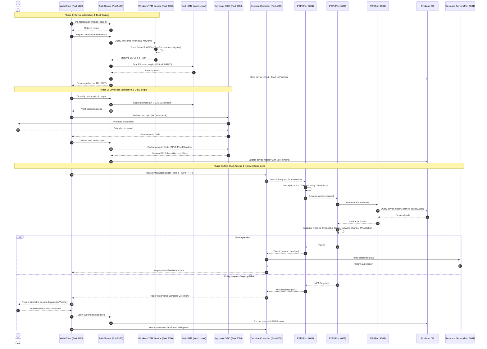

# Hardware-Rooted Zero-Trust Architecture (ZTA) with TPM, SoftHSM2, OIDC & DPoP

This repository demonstrates a complete, hardware-rooted **Zero-Trust Architecture (ZTA)** that integrates device trust, user identity, cryptographically bound tokens, and dynamic policy evaluation.

By combining **TPM (Trusted Platform Module) Attestation**, **SoftHSM2 Hardware Security Module (HSM) Key Sealing**, **Keycloak OpenID Connect (OIDC)** with **PKCE & DPoP**, and **WebAuthn MFA**, this system ensures that only verified users on authorized, untampered devices can access classified resources.

---

## 🛠️ Architectural Overview

The system operates across three core phases:
1. **Device Attestation & Trust Sealing**: Validating the hardware properties of the machine using TPM 2.0 and sealing its Endorsement Key (EK) hash using SoftHSM2 via `pkcs11-tool`.
2. **Device-Bound Authentication**: Authenticating the user via Keycloak OIDC, enforcing Proof-of-Possession (DPoP) at the application layer to bind the access token cryptographically to the device.
3. **Continuous Authorization & Policy Enforcement**: A multi-point Policy Engine (PEP/PDP/PIP) that continuously checks the request context (network changes, geographic impossible travel, and step-up MFA requirements) before granting access.

### 🧬 ZTA Authentication & Authorization Flow



---

## 🎛️ Component Services & Port Map

The local system is designed around a microservice topology to simulate a standard enterprise security architecture:

| Service | File | Port | Description |
| :--- | :--- | :--- | :--- |
| **Auth Gateway / Portal** | `server.js` | `5173` | Hosts the Web Client, coordinates OIDC login callbacks, and conducts WebAuthn enrollment. |
| **Decision Controller** | `decision-controller.js` | `4000` | Orchestrates client requests for protected resources, passing tokens and IP signals to the PEP. |
| **Policy Enforcement (PEP)** | `pep.js` | `4001` | Token validation gatekeeper. Decodes DPoP proofs and verifies access tokens against Keycloak JWKS. |
| **Policy Decision (PDP)** | `pdp.js` | `4002` | Policy engine. Applies ZTA checks: impossible travel speeds, user-device mismatch, and IP anomalies. |
| **Policy Information (PIP)** | `pip.js` | `4003` | Context provider. Fetches/saves real-time device telemetry (IP, location history) from Firebase. |
| **Device Registry** | `services/device-registry.js` | `4004` | Admin service to register, read, or revoke device status in the Firebase database. |
| **Attestation Verifier** | `services/attestation-service.js` | `4005` | Mock service verifying the hardware confidence of incoming device requests. |
| **Protected Resource** | `services/resource-server.js` | `5001` | Simulates the internal API serving classified audit data from Firebase. |
| **Windows TPM Agent** | `tpm-agent.js` | `7000` | Optional client-side agent to fetch local Windows TPM parameters on demand. |
| **Windows TPM Service** | `tpm-service.js` | `9000` | Windows service that runs the PowerShell script to extract EK cert/hash and respond to the Mac/Linux gateway. |

---

## 📋 Prerequisites & Configuration

### 1. Keycloak Configuration
Run a Keycloak server (e.g., on port `8080`) and configure the following settings:
- **Realm**: Create a new realm named `zta-realm`. **Do not use the master realm.**
- **Client ID**: `remote-work-app`
- **Root URL**: `http://localhost:5173`
- **Redirect URI**: `http://localhost:5173/callback`
- **Web Origins**: `http://localhost:5173`
- **Client Authentication**: Disabled (Public Client)
- **Standard Flow** & **Direct Access Grants**: Enabled
- **Proof Key for Code Exchange (PKCE)**: Force `S256` method.

### 2. SoftHSM2 Installation & Sealing Key Setup
To sign the Endorsement Key (EK) hash securely, SoftHSM2 and `pkcs11-tool` must be configured locally.

**Installation**:
*   **macOS**: `brew install softhsm`
*   **Debian/Ubuntu**: `sudo apt-get install softhsm2 opensc`

**Initialize Token Slot**:
Initialize slot `0` with the user PIN matching `1234` used in the codebase (`hsm.js`):
```bash
softhsm2-util --init-token --slot 0 --label "zta-tpm" --pin 1234 --so-pin 1234
```

**Generate HMAC Key**:
Generate a 256-bit symmetric key under ID `01` inside the initialized token:
```bash
# On macOS:
pkcs11-tool --module /opt/homebrew/lib/softhsm/libsofthsm2.so --login --pin 1234 --token-label "zta-tpm" --keygen --key-type generic-secret:32 --id 01 --label "ek-hmac-key"

# On Linux:
pkcs11-tool --module /usr/lib/softhsm/libsofthsm2.so --login --pin 1234 --token-label "zta-tpm" --keygen --key-type generic-secret:32 --id 01 --label "ek-hmac-key"
```

> [!NOTE]
> If running on macOS, update the `MODULE` path inside [hsm.js](./hsm.js) from `/usr/lib/softhsm/libsofthsm2.so` to `/opt/homebrew/lib/softhsm/libsofthsm2.so`.

### 3. Firebase Configuration
The system uses Firebase Realtime Database to store device registries, WebAuthn MFA credentials, and company protected resources.

1. Create a Firebase project and generate a new Service Account Private Key (JSON format).
2. Create a `.env` file in the project root (you can copy `.env.example` to start):
   ```bash
   cp .env.example .env
   ```
3. Populate `.env` with your project's credentials.
4. **Seed Database Mock Data**: To prevent the Resource Server from throwing errors, initialize your Firebase database with the following structure:
   ```json
   {
     "audit_reports": {
       "company": {
         "confidential_metrics": {
           "revenue_growth": "+12.4%",
           "active_vpn_tunnels": 42,
           "security_incidents_resolved": 100
         },
         "system_status": "All systems nominal"
       }
     }
   }
   ```

---

## 🚀 Running the System

### 1. Windows TPM Attestation Setup
On the Windows client machine containing a TPM 2.0 chip:
1. Copy the contents of the `public/` folder to your Windows environment (e.g., `E:\zta-tpm-oidc-dpop\public`).
2. Run `node tpm-service.js` (listening on Port `9000`) or run `node tpm-agent.js` (listening on Port `7000`) to expose the TPM attestation script.
3. Make sure the Windows machine's IP address matches the `WINDOWS_HOST` value configured in your gateway's [server.js](./server.js).

### 2. Start All Local Services
A helper script is provided to spin up all 8 local backend services simultaneously. Execute this in your workspace directory:
```bash
./start-zta.sh
```

To stop all background services, simply hit `Ctrl+C` in the terminal.

---

## 🛡️ Zero-Trust Policy Rules

The authorization engine ([pdp.js](./pdp.js)) enforces the following strict zero-trust checks:

*   **User-Device Binding**: Denies access if the authenticated user's ID does not match the registered user bound to the device's TPM fingerprint.
*   **Network Change Detection**: Triggers a step-up MFA challenge if the user's client IP differs from the last verified IP.
*   **Geographic Location Drift**: Forces step-up MFA if the country of request shifts.
*   **Impossible Travel**: Detects speeds >900 km/h between sequential logins using the Haversine formula and forces biometrics verification before granting access.
*   **Resource Sensitivity**: Enforces mandatory WebAuthn MFA when accessing highly sensitive scopes (`company.audit` or `admin.panel`) from unknown network segments.